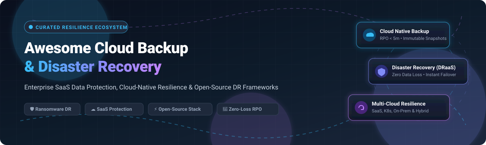

  

# 🛡️ Awesome Cloud Backup & Disaster Recovery

  
  
  
  
  

> 🚀 **A curated directory of premier Enterprise SaaS platforms and top Open-Source GitHub tools dedicated to Cloud Backup, Disaster Recovery as a Service (DRaaS), Ransomware Cyber-Resilience, and Continuous Business Continuity.**

---

## 📑 Table of Contents

- [🌐 Sector Overview & Market Dynamics](#-sector-overview--market-dynamics)
- [🏢 SaaS & Hosted Platforms](#-saas--hosted-platforms)
- [💻 Open-Source GitHub Projects](#-open-source-github-projects)
- [🧰 Non-GitHub Open-Source Tools](#-non-github-open-source-tools)
- [🤝 How to Contribute](#-how-to-contribute)
- [💖 Support](#-support)
- [📈 Star History](#-star-history)
- [⚖️ Disclaimer](#-disclaimer)

---

## 🌐 Sector Overview & Market Dynamics

The global Cloud Backup and Disaster Recovery as a Service (DRaaS) market represents an estimated **$15B – $21B+** ecosystem, projected to expand rapidly beyond **$34B** driven by intensifying ransomware threats, strict compliance frameworks (NIS2, DORA, HIPAA, GDPR), and hybrid multi-cloud proliferation. The market is **moderately fragmented**: legacy enterprise backup giants and hyper-scale cloud platforms dominate foundational infrastructure, yet nimble specialized SaaS vendors capture substantial market share through purpose-built connectors for modern SaaS ecosystems (Salesforce, Microsoft 365, Google Workspace, ServiceNow, Atlassian) and cloud-native Kubernetes workloads.

---

## 🏢 SaaS & Hosted Platforms

Enterprise SaaS solutions sorted descending by company scale (market capitalization, enterprise valuation, or annual revenue):

| 🏢 Product / Platform | 💰 Scale (Revenue / Valuation) | 🏷️ Specific Starting Pricing | 🎁 Free Tier / Free Trial Limits | 🔍 Description |
|---|---|---|---|---|
| **[Salesforce Backup](https://www.salesforce.com/)** | **~$275B Market Cap** ($38B+ Annual Revenue) | **~$4.00 – $5.00** per user / month (billed annually as an add-on) | **30-day free trial** available via sales consultation; 0 forever-free tier | Native Salesforce data backup and recovery service providing daily automated backups with configurable retention and metadata restoration. |
| **[Veeam Backup for Salesforce](https://www.veeam.com/)** | **~$15B Valuation** ($1.5B+ Annual Revenue) | **~$4.17** per user / month ($50/user/year billed annually, 10-pack minimum) | **Free Community Edition: Forever free up to 50 user licenses** with full backup/restore features | Salesforce backup and recovery with granular restore, metadata protection, and integration into Veeam's broader data platform ecosystem. |
| **[AvePoint Cloud Backup](https://www.avepoint.com/)** | **~$3.5B Market Cap** ($419.5M Annual Revenue) | **~$3.00 – $4.50** per user / month (annual subscription) | **30-day free trial** with full multi-cloud backup access across Microsoft 365, Google Workspace, and Salesforce; 0 forever-free tier | Enterprise SaaS backup for Microsoft 365, Google Workspace, Salesforce, and Dynamics 365 with compliance-focused retention. |
| **[Druva inSync](https://www.druva.com/)** | **~$2.0B Valuation** ($250M+ ARR) | **~$2.50 – $4.00** per endpoint / user / month (starts with Business edition) | **30-day free trial** with full access to cloud backup, endpoint data loss prevention, and ransomware scanning; 0 forever-free tier | Cloud-native 100% SaaS data protection platform with endpoint backup, Microsoft 365 protection, and automated ransomware rollback. |
| **[OwnBackup (Own)](https://www.ownbackup.com/)** | **~$1.9B Acquisition** (Acquired by Salesforce) | **~$3.50 – $4.50** per user / month (annual contract) | **14-day free trial** with live sandbox seeding and backup evaluation; 0 forever-free tier | Leading Salesforce backup and recovery platform with automated daily backups, sandbox seeding, and intelligent recovery for metadata and data. |
| **[Spanning Backup](https://spanning.com/)** | **~$1.5B Valuation** (Parent Kaseya) | **~$4.00** per user / month ($48/user/year) | **14-day free trial** for up to 25 users with automated daily backups across M365 or Google Workspace; 0 forever-free tier | SaaS data protection for Microsoft 365, Google Workspace, and Salesforce with automated daily snapshots, granular restores, and ransomware rollback. |
| **[HYCU](https://www.hycu.com/)** | **~$350M Valuation** | **~$1.20** per user / month (identity apps) up to **$4.00** per user / month for suite apps; Starter bundle from **$5,000 / year** | **14-day free trial** with full R-Cloud integration access; free tier available for selected custom R-Cloud connectors | Multi-cloud and SaaS data protection platform supporting Nutanix, VMware, Google Cloud, AWS, Azure, and dozens of SaaS business apps. |
| **[Keepit](https://www.keepit.com/)** | **~$250M Valuation** | **~$3.50 – $4.50** per user / month (includes unlimited storage & retention) | **30-day free trial** with full access to independent immutable storage and restore validation; 0 forever-free tier | Independent vendor-neutral cloud backup for Microsoft 365, Google Workspace, and Salesforce with dedicated immutable blockchain-like storage. |
| **[Odaseva](https://odaseva.com/)** | **~$150M Valuation** | **~$1,000 / month** minimum platform tier (or ~$5,000 / year for Professional enterprise tier) | **30-day free trial** / proof-of-concept for enterprise sandbox and production environments; 0 forever-free tier | Enterprise Salesforce data protection platform engineered for massive data volumes, ultra-fast archival, and strict global compliance mandates. |
| **[Rewind](https://rewind.com/)** | **~$120M Valuation** | **~$4.00** per user / month (Standard SaaS) or **$9.00 / month** (Ecommerce basic tier) | **14-day free trial** for Shopify/BigCommerce/GitHub/Jira with complete automated restore capability; 0 forever-free tier | Automated cloud backup and instantaneous recovery for Shopify, BigCommerce, QuickBooks, GitHub, Jira, and Confluence. |

---

## 💻 Open-Source GitHub Projects

Explore the top open-source repositories powering self-hosted, cloud-native, and infrastructure-as-code disaster recovery. Sorted descending by GitHub Stars_Count:

- **[Rclone](https://github.com/rclone/rclone)**   
  ⚡ *60k+ Stars* • High-performance command-line program to sync and transfer files across 70+ cloud storage backends (AWS S3, Google Drive, Azure Blob, Dropbox, Backblaze B2, SFTP, and WebDAV) with on-the-fly encryption, compression, and virtual mount support.

- **[Restic](https://github.com/restic/restic)**   
  ⚡ *36k+ Stars* • Secure, fast, and modern backup program written in Go. Features zero-trust authenticated cryptography, content-defined chunking and deduplication, atomic snapshot management, and native streaming to local disks, SFTP, REST, S3, MinIO, and Azure.

- **[Kopia](https://github.com/kopia/kopia)**   
  ⚡ *14k+ Stars* • Fast cross-platform backup and restore tool for Windows, macOS, and Linux. Built with client-side end-to-end encryption, multi-codec compression, global deduplication, customizable scheduling, CLI, and intuitive desktop/web graphical interfaces.

- **[BorgBackup](https://github.com/borgbackup/borg)**   
  ⚡ *13k+ Stars* • Battle-tested deduplicating archiver with authenticated AES-256 encryption. Delivers space-efficient differential backups, mountable FUSE filesystem archives, append-only repository protection against ransomware, and granular retention pruning.

- **[Velero](https://github.com/vmware-tanzu/velero)**   
  ⚡ *10k+ Stars* • Industry-standard Kubernetes backup, disaster recovery, and workload migration tool. Backs up cluster resource manifests and persistent volume snapshots across AWS, Azure, GCP, and on-premises storage plugins with scheduled DR rehearsals.

- **[Longhorn](https://github.com/longhorn/longhorn)**   
  ⚡ *8k+ Stars* • CNCF graduated cloud-native distributed block storage built natively for Kubernetes. Provides built-in thin-provisioned snapshots, scheduled incremental backups to secondary object storage (S3/NFS), and cross-cluster active-standby DR volume replication.

- **[pgBackRest](https://github.com/pgbackrest/pgbackrest)**   
  ⚡ *4.4k+ Stars* • High-throughput, production-grade backup and restore orchestrator for PostgreSQL. Features parallelized full/differential/incremental backups, delta restores, page checksum verification, encryption, and direct streaming to AWS S3, Azure Blob, and GCS.

- **[WAL-G](https://github.com/wal-g/wal-g)**   
  ⚡ *4.3k+ Stars* • Modern archival and disaster restoration tool for cloud-hosted databases. Successor to WAL-E written in Go, providing continuous Write-Ahead Log (WAL) archiving and point-in-time recovery for PostgreSQL, MySQL, MongoDB, Redis, and FoundationDB.

- **[Barman](https://github.com/EnterpriseDB/barman)**   
  ⚡ *3.2k+ Stars* • Backup and Recovery Manager for PostgreSQL (GPL-3.0), maintained by EnterpriseDB. Enables remote continuous backups of multiple PostgreSQL clusters in enterprise deployments with zero-data-loss RPO and Point-In-Time Recovery (PITR).

- **[Plakar](https://github.com/PlakarKorp/plakar)**   
  ⚡ *2.0k+ Stars* • Modern open-source backup framework (ISC license) powered by the "Kloset" format. Delivers client-side zero-knowledge encryption, source-level content chunking, immutable snapshot repositories, and connectors for files, databases, S3, and SaaS endpoints.

- **[Bareos](https://github.com/bareos/bareos)**   
  ⚡ *1.2k+ Stars* • 100% open-source enterprise cross-network backup solution (AGPL-3.0). Reliably coordinates client-storage-director architectures, archiving and recovering heterogeneous environments across Linux, Windows, macOS, cloud object stores, and physical tape libraries.

- **[Relax-and-Recover (ReaR)](https://github.com/rear/rear)**   
  ⚡ *1.1k+ Stars* • The foremost bare-metal disaster recovery and system migration framework for Linux. Automatically generates bootable rescue media (ISO, PXE, USB) while seamlessly integrating with Borg, Bacula, Bareos, Duplicity, and enterprise backup backends.

- **[UrBackup](https://github.com/uroni/urbackup_backend)**   
  ⚡ *930+ Stars* • Client/server network backup solution for Windows, macOS, and Linux. Performs continuous background file-level backups and image-level volume snapshots without disrupting active operating system operations.

- **[Kanister](https://github.com/kanisterio/kanister)**   
  ⚡ *880+ Stars* • CNCF sandbox framework for application-level data management in Kubernetes. Orchestrates blueprint-driven application-consistent backups, restore routines, and cross-region DR failovers for stateful enterprise databases.

- **[BackupSheep](https://github.com/bilal414/backupsheep)**   
  ⚡ *190+ Stars* • Automated server and database snapshot backup platform. Provides automated preflight disk checks, instant one-click restores, credential encryption, and multi-channel alerting across Slack, Discord, and Telegram.

- **[Bacula-Web](https://github.com/bacula-web/bacula-web)**   
  ⚡ *150+ Stars* • Web-based monitoring and analytical reporting dashboard for Bacula backup infrastructure, tracking backup catalogs, director jobs, pool health, and storage utilization.

- **[Stronghold](https://github.com/mehdi-arfaoui/stronghold)**   
  ⚡ *36+ Stars* • Open-source disaster recovery automation platform for cloud infrastructure. Features DR contract validation, RTO/RPO verification, infrastructure dependency graphing, single-point-of-failure detection, and automated CI/CD DR compliance gates.

- **[Snapr](https://github.com/maximseshuk/snapr)**   
  ⚡ *10+ Stars* • Lightweight Go-based self-hosted backup orchestration service. Supports scheduled dumps for PostgreSQL, MySQL, MariaDB, MongoDB, Redis, and SQLite with AES encryption, cloud sync, and web UI management.

- **[Vanguard](https://github.com/Kadantte/vanguards)**   
  ⚡ *Community* • Open-source Laravel-based server and application backup solution. Offers scheduled job queues, granular notifications (Email, Discord, Slack, Pushover), 2FA authentication, and encrypted offsite storage.

- **[DaliBackup-OSS](https://github.com/daliranas/DaliBackup-OSS)**   
  ⚡ *Community* • Sovereign Docker-ready DR orchestration supporting Microsoft Hyper-V (VSS consistent), Proxmox VE (QEMU & LXC), and IMAP mailboxes with zero-trust AES-256-GCM encryption.

---

## 🧰 Non-GitHub Open-Source Tools

- **[Duplicity](https://gitlab.com/duplicity/duplicity)** — Encrypted, bandwidth-efficient backup solution using standard librsync algorithms and GnuPG (hosted on GitLab).
- **[CloudRecovery](https://pypi.org/project/cloudrecovery/)** — AI-assisted incident recovery tool (Python) providing policy-guarded execution runbooks for site-down and Kubernetes crashloop triage.

---

## 🤝 How to Contribute

Contributions are warmly welcomed! Help make this curated knowledge base more valuable:

1. 🍴 **Fork** this repository.
2. 🌿 Create a new feature branch (`git checkout -b feature/add-new-dr-tool`).
3. 📝 Update `README.md` with your new SaaS product or open-source tool following existing formats.
4. 🚀 Submit a detailed **Pull Request** explaining why the tool belongs in this guide.

---

## 💖 Support

If you find this repository helpful for your cloud infrastructure, disaster recovery planning, or enterprise DevOps stack:

- ⭐ **Star** this repository on GitHub!
- 🍴 **Fork** and share it with colleagues and DevOps teams!
- ☕ **Buy me a coffee / Sponsor**: If you'd like to support ongoing maintenance and curation of open-source resources, please visit the [GitHub Sponsors Dashboard](https://github.com/sponsors/ishandutta2007). Thank you for your support! 🙌

---

## 📈 Star History

---

## ⚖️ Disclaimer

- This repository is a **community-curated guide** intended for informational and educational purposes; listings do not constitute commercial endorsements.
- Backup, recovery, and data processing procedures must comply with regional and industry data privacy regulations (GDPR, CCPA, HIPAA, PCI-DSS, SOC 2).
- Always verify, test, and perform routine recovery dry-runs of self-hosted open-source backup architectures in non-production environments prior to production rollout.

---

  <b>Built with ❤️ for IT Admins, DBAs, Cloud Architects, and DevOps Teams Worldwide.</b>

